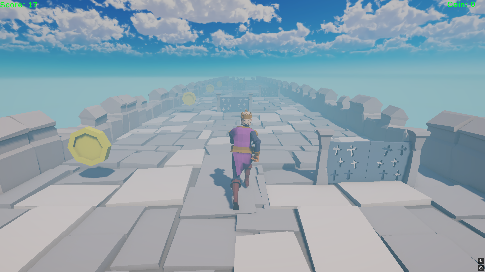
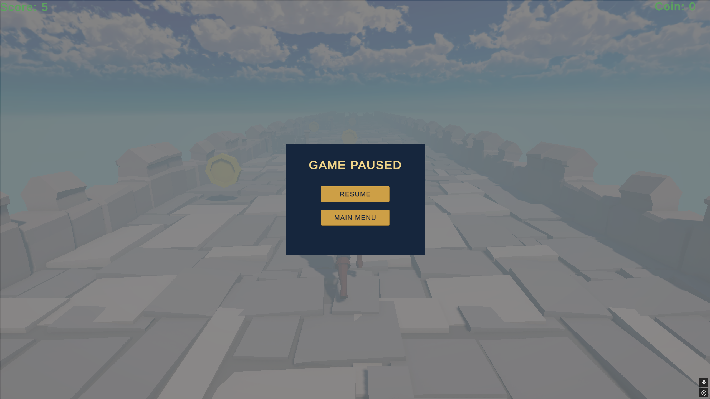
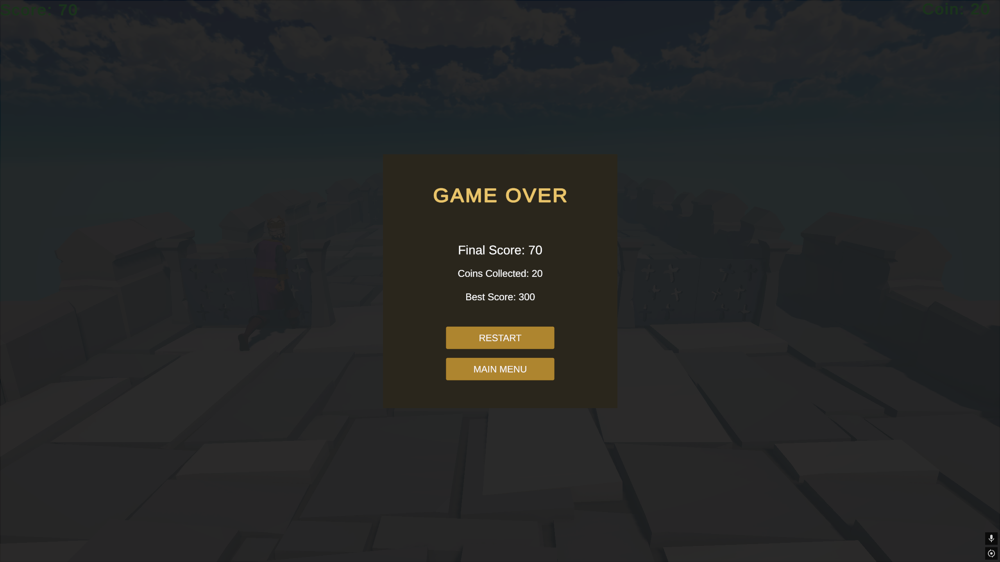

# 👑 Royal Run

A 3D endless runner game built with **Unity 6**, where you guide a royal runner through an endless obstacle-filled kingdom. Dodge obstacles, collect coins, survive as long as possible, and beat your personal best!

## 🎮 Game Preview


## ✨ Features

- **Endless Gameplay:** Dynamically generated level chunks for continuous running.
- **Obstacle System:** Dodge fences and other obstacles along the way.
- **Three-Strike Mechanic:** Survive your first two collisions, but the third ends your run.
- **Coin Collection:** Collect coins while navigating the course.
- **Scoring System:** Score increases as you survive longer.
- **Best Score Tracking:** Personal best saved between sessions.
- **Game States:** Main Menu, Pause, Resume, Game Over and Restart.
- **Audio System:** Separate background music and sound-effect controls.
- **Atmospheric Fog:** Distance fog helps conceal distant object spawning.

## 🕹️ Controls

| Action | Input |
|---|---|
| Movement | WASD |
| Pause / Resume | Escape |

## 🛠️ Built With

- Unity 6 (6000.3 LTS)
- C#
- Unity New Input System
- TextMeshPro
- Unity Audio Mixer
- Git & GitHub

## 📸 Screenshots


| Main Menu | Gameplay |
|---|---|
|  |  |

| Pause Menu | Game Over |
|---|---|
|  |  |

## 🚀 Getting Started

### Requirements
- Unity 6 (6000.3 LTS)
- Git

### Run Locally

1. Clone this repository:
   ```bash
   git clone https://github.com/Kaushal-05/Royal-Run.git
   ```
2. Open Unity Hub.
3. Select **Add Project from Disk**.
4. Select the cloned Royal Run folder.
5. Open the project using the appropriate Unity version.
6. Open the MainMenu scene and press Play.

## 📦 Download

A standalone Windows build is available separately. Check the repository's Releases section for downloadable builds.

## 🙌 Credits & Acknowledgements

Thanks to the creators of the 3D assets, music, sound effects, and other resources used in this project.

Individual asset and audio credits will be listed here with their respective sources and licenses.

## 👨‍💻 Developer

**Kaushal (Bhalu)**

Game Developer | Unity & C#

- GitHub: [Kaushal-05](https://github.com/Kaushal-05)

---

If you enjoyed the project, consider giving the repository a ⭐!

**Made with Unity and lots of debugging.** 🐻
